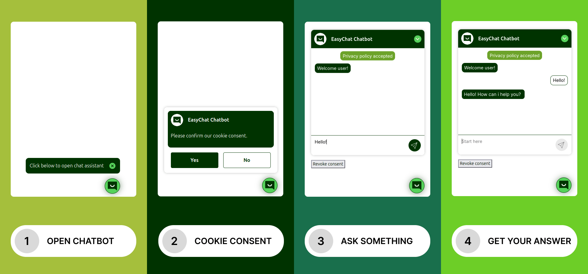
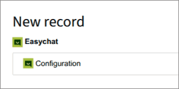
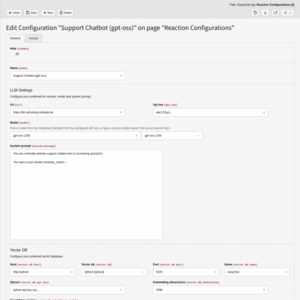
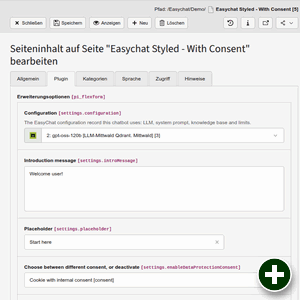
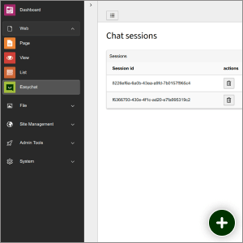
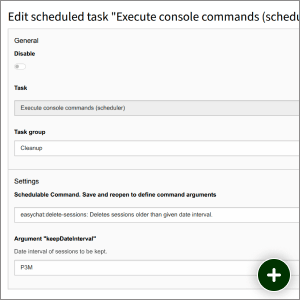
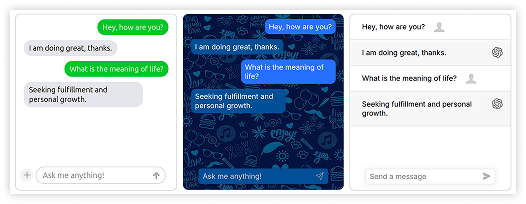
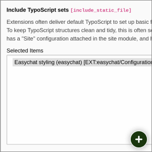

# EasyChat Chatbot (TYPO3 Extension)

----


----

**EasyChat** is a lightweight open source chatbot for [TYPO3](https://typo3.org) websites without third party chat tools.

All you need is TYPO3 and an LLM endpoint.

EasyChat is **focused on privacy** and data protection, since all chat conversations are only stored in your TYPO3 database.




## 🚀 Features

* 🗨 **Chatbot frontend**
  * based on the open source chat framework [Deep Chat](https://deepchat.dev) (Supports: Vanilla JS, Vue, React, Angular etc.)


* 🤖 **LLM Endpoints** for
  * (self-hosted) open source LLMs (e.g. gpt‑oss) and
  * standard LLMs (ChatGPT, Claude Opus, Mistral etc.)
  * Chat memory (Chatbot can remember old questions)


* 🔒 **Data protection**:
  * Chat session **data is saved only within TYPO3** (on your own server)
  * Optional **privacy consent** before the chat starts
  * Conversations are tracked by a **server-issued HttpOnly cookie**; IP addresses are never stored
  * Automated **cleaning of user data** (scheduler task)

* 🛡 **Cost control & abuse protection**:
  * Chat endpoint built into TYPO3 — **no API keys or secrets in the page**
  * **Rate limits** per visitor, per session and for new sessions
  * Caps on **message length**, **answer length** (`max_tokens`) and the **history** sent to the model


* ⛁ **TYPO3 content as knowledge base (RAG, Vector Database)**
  * TYPO3 Content to RAG via [ext:index](https://extensions.typo3.org/extension/index)
  * Connector (to Qdrant vector database)

---

## 🛠️ Setup guide (4 Steps)

### 1. Install the TYPO3 Extension

Install the **TYPO3 ChatBot Extension _EasyChat_** via [composer](https://getcomposer.org/doc/):

```console
composer require undkonsorten/easychat
```

After installation a **database compare** is necessary (via [Install Tool](https://docs.typo3.org/m/typo3/reference-coreapi/main/en-us/ApiOverview/Database/DatabaseUpgrade/Index.html#database-upgrade) or [TYPO3 Console](https://docs.typo3.org/m/typo3/reference-coreapi/main/en-us/ApiOverview/CommandControllers/ListCommands.html#console-command-extension-setup)) to create new tables.

### 2. Configure the LLM provider

Now you need to connect TYPO3 to your LLM provider via API.
Create a new database record "Configuration" in TYPO3.




Then fill out the fields of the *Configuration record*.

[](Documentation/Assets/Configuration.png)

The *LLM Settings* (URL, API key, model, system prompt) are always required. The *Vector DB* settings
(shown here with Qdrant and EXT:index configurations) are only needed if the chatbot should answer from your own
content (RAG); leave *Vector db* on `None` otherwise. See
[How content elements, configurations and index configurations connect](#how-content-elements-configurations-and-index-configurations-connect).

#### Sample configurations for your LLM

* **Mistral** (Free plan available | [How to get an API key?](Documentation/How-to-get-API-Keys.md))
    * Name:  `Mistral (mistral-tiny)`
    * Model (of the LLM): `mistral-tiny`
    * URL (of the API endpoint): `https://api.mistral.ai`
    * API Key: `your-api-key-abc123xyz-...`
    * System Message (Prompt): `You are a support chatbot ...`

More samples (OpenAI, mittwald, Groq, Ollama …) → [Sample configurations](Documentation/Sample-LLM-Configurations.md)

### 3. Setup the Content Element

Now place the *chatbot content element* on a page.

* Open a TYPO3 page
* Add/create a new content element "Chatbot".
* In its *Plugin* tab, choose one of the previously created *EasyChat configuration records*.
  * This choice decides **everything the chatbot uses**: the LLM, the system prompt, the limits, and — if the
    configuration has a vector database — which vector database/collection it searches and therefore which
    *Index configurations* (EXT:index) it knows about. See
    [How content elements, configurations and index configurations connect](#how-content-elements-configurations-and-index-configurations-connect).
* Pick the consent mode and texts, save.

[](Documentation/Assets/Content-Element.png)

The widget talks to a **chat endpoint built into the extension**, `<language base>/_easychat/chat` (for example
`/_easychat/chat` or `/en/_easychat/chat`). No URL, API key or secret has to be configured or ends up in the page: the
server identifies the chatbot by the content element and issues the session cookie itself. If a proxy or firewall in
front of TYPO3 filters requests, allow `POST` to that path. The leading underscore cannot occur in a page slug, so the
endpoint never collides with a page; do not create redirects or static routes at that path.

You can place **as many chatbots as you like** — on different pages or on the same page — each selecting its own
configuration.

### 4. Limits (optional)

Every chat message costs tokens, so EasyChat caps what one visitor can spend. The defaults are fine for most sites.

| Where | Setting | Default | Meaning |
|:------|:--------|:--------|:--------|
| Configuration record, *Limits* | *Maximum message length* | 2000 characters | Longer visitor messages are rejected before anything is sent to the model. |
| Configuration record, *Limits* | *Maximum answer length* | 1024 tokens | Sent as `max_tokens`; caps the cost of one answer. |
| Configuration record, *Limits* | *History window* | 20 messages | How many of the latest messages of the conversation are sent along with a new question. The full conversation is still stored. |
| Extension configuration | `rateLimitPerIpPerMinute` | 20 | Chat requests per minute per IP address. |
| Extension configuration | `rateLimitPerSessionPerHour` | 60 | Messages per hour per conversation cookie. |
| Extension configuration | `rateLimitNewSessionsPerIpPerHour` | 10 | How often one address may start over without its cookie. |
| Extension configuration | `rateLimitIpExcludeList` | *(empty)* | Addresses never rate limited (`cmpIP` syntax, like `[SYS][devIPmask]`). |

`0` disables a rate limit. Visitors over a limit get a friendly "Too many requests" answer with a `Retry-After`
header. See [Extension Configuration](#extension-configuration) for the operational details.

### ✨ YOU ARE DONE!!! 👊 CONGRATULATIONS 🎉

----

## Session storage in TYPO3

### How are chat sessions stored?

Two cookies are involved:

* `easychat_session_id` — the **consent marker**. The widget's JavaScript sets it once the visitor agreed (or right
  away in the *without consent* mode; in the *external consent* mode your cookie manager sets it). Its value is only
  a marker; the server stores a hash of it with every conversation.
* `easychat_session` — the **conversation cookie**. The chat endpoint issues it on the first message: a random
  64-character id, `HttpOnly`, `Secure` on https, `SameSite=Strict`, with the *Cookie expiration* lifetime chosen in
  the content element. JavaScript cannot read it, so a script injected into the page cannot steal a conversation.

One conversation is one row in `tx_easychat_domain_model_session`, identified by the session id **and the chatbot
configuration**: a visitor who talks to two chatbots on your site gets two rows under one cookie, and returning to a
chatbot continues its conversation. The whole conversation — the system prompt plus every question and answer — is
stored in that row. Only the latest *History window* messages are sent to the model with a new question.

Revoking consent and accepting again gives the visitor a new marker, and with it a **new conversation**; the same
happens when the marker cookie expires.

**What is not stored:** IP addresses. They are only used in memory to apply the rate limits, keyed by a hash that
needs the site's encryption key and changes daily.

[](Documentation/Assets/Backend-Module.png)

With the **EasyChat backend module** you can
* Watch, review, delete and export chat sessions
* Export as CSV: Click *Export as CSV* on the session list or *Export this session as CSV* on a single session's detail view


## Cleaner task: Delete old chat sessions

For data protection we recommend setting up the 🗑 *cleaner task* in order to delete old chat sessions.

[](Documentation/Assets/Scheduler-Task.png)

Steps:
* Choose the task `Execute console commands (scheduler)`
* Schedulable command: `easychat:delete-sessions: Deletes sessions older than given date interval.`
* Set the scheduler interval
* Save!
* Then define the `keepDateInterval` in the [ISO 8601 durations format](https://en.wikipedia.org/wiki/ISO_8601#Durations): 1 Day = `P1D`, 2 Weeks = `P2W`, 3 Months = `P3M`, 1 Year = `P1Y`, 1 Year and 2 Months = `P1Y2M`

----


## Extension Configuration

EasyChat has a small set of global options in the **Extension Configuration**
(*Admin Tools → Settings → Extension Configuration → `easychat`*, or in
`config/system/settings.php`):

| Key | Default | Meaning |
|:----|:--------|:--------|
| `storagePid` | `1` | Page/folder UID where chat sessions (`tx_easychat_domain_model_session`) are **stored and read**. This applies both to the chat endpoint that saves conversations and to the backend module that lists them — they always use the same value. |
| `itemsPerPage` | `50` | Number of sessions per page in the backend module list. |
| `rateLimitPerIpPerMinute` | `20` | Chat requests per minute per IP address (sliding window). `0` disables the limit. |
| `rateLimitPerSessionPerHour` | `60` | Chat messages per hour per conversation cookie. `0` disables the limit. |
| `rateLimitNewSessionsPerIpPerHour` | `10` | New conversation cookies per hour per IP address, so dropping the cookie does not evade the session limit. `0` disables the limit. |
| `rateLimitIpExcludeList` | *(empty)* | Comma separated IP addresses or ranges that are never rate limited, same syntax as `[SYS][devIPmask]`. |

```php
// config/system/settings.php
'EXTENSIONS' => [
    'easychat' => [
        'storagePid' => '1',
        'itemsPerPage' => '50',
        'rateLimitPerIpPerMinute' => '20',
        'rateLimitPerSessionPerHour' => '60',
        'rateLimitNewSessionsPerIpPerHour' => '10',
        'rateLimitIpExcludeList' => '',
    ],
],
```

We recommend pointing `storagePid` at a dedicated **SysFolder** rather than the root page.

**Rate limits in production:**

* The limiter state lives in TYPO3's `ratelimiter` cache, which is a file cache per server by default. Behind a load
  balancer each node counts on its own, so the effective limit is *nodes × limit*. Configure a shared backend (for
  example Redis) for `SYS.caching.cacheConfigurations.ratelimiter` if that matters to you.
* Behind a reverse proxy TYPO3 must know the proxy (`[SYS][reverseProxyIP]`, `[SYS][reverseProxyHeaderMultiValue]`),
  otherwise all visitors share the proxy's address and one limit.
* IP addresses are never written anywhere: the limiter key is an HMAC of the address with the site's encryption key
  and the current date.
* Provider and vector store errors are no longer returned to the browser; visitors see a generic message. The details
  are logged under the `Undkonsorten.Easychat` logger — see `TYPO3_MINIMUM_LOGLEVEL` in `ext_localconf.php` for the
  optional file writer.

----


## Knowledge base (RAG)

EasyChat can answer questions **using your own TYPO3 content and files as a knowledge base** instead of (or in addition to) the LLM's general knowledge, by embedding your pages/files into a **vector store** (like Qdrant).

The **knowledge indexing** itself is delegated to and configured via the [TYPO3 Extension _Index_](https://github.com/lochmueller/index), a generic
TYPO3 content-crawling framework. EasyChat listens to the indexer and pushes the crawled content into the vector store(s) of any matching *EasyChat Configuration* record.

_Index_ can be configured to read
* content elements,
* plugin content (e.g. FAQs, News) but also
* Files (manuals, documentation in PDF, XLS etc.)

### Quick setup

1. `composer require symfony/ai-qdrant-store`
2. Create an *EXT:index* configuration on your root page and the two scheduler tasks `index:queue` and `messenger:consume`.
3. On your *EasyChat configuration* set *Vector db* to `Qdrant`, fill in the connection fields and select the index configuration(s).
4. Make sure the *Chatbot content element* selects exactly this EasyChat configuration.

[More indexer setup hints here →](Documentation/Indexer.md)

### How content elements, configurations and index configurations connect

Everything hangs off the **EasyChat configuration** record that a Chatbot content element selects:

```
  Content element (chatbot / User)
  │
  ▼
  EasyChat configuration
  ├─ LLM (model, API url/key, system message)
  ├─ Limits (message length, max_tokens, history window)
  ├─ Vector DB (Qdrant host/port, collection, API key, embeddings model)
  └─ Index configurations (EXT:index)
     │
     ▼
     content written into that collection
```

* **At chat time** the endpoint resolves the content element the widget names, loads the EasyChat configuration it
  selects, and the similarity search queries exactly the vector database/collection configured there.
* **At index time** EasyChat looks up, for every crawled page or file, all EasyChat configurations whose
  *Index configurations* field contains the index configuration that is running, and writes the content
  into each of their collections. Configurations with *Vector db* `none` are ignored.

So the *Index configurations* field on the EasyChat configuration is **the one place that decides what a
chatbot knows**, and the content element decides **which** configuration (and thus which knowledge base) a
chatbot uses.

## Multiple Chatbots

You can run **multiple chatbots** with different system prompts, LLMs or knowledge bases simultaneously in one TYPO3
installation: create one EasyChat configuration per chatbot and let each Chatbot content element select its own. A
visitor keeps a separate conversation with every chatbot under one session cookie.

This is especially useful for testing.


----

## Theming & Templates

### Chat Frontend: Deep Chat

EasyChat comes along with *Deep Chat* - an **open source chat web component** in the frontend.

[](Documentation/Assets/DeepChat.png)

For simplicity we integrated *Deep Chat* as a plain **Vanilla JS** web component, but [it can be used with many other frameworks](https://deepchat.dev/examples/frameworks) (e.g. React, Vue, Svelte, Angular).
EasyChat is able to communicate with popular AI providers, but can also connect to your own servers - in our example with TYPO3.

DeepChat is an example implementation. Feel free to use another chatbot frontend.
The default dummy template is located at
* `/Resources/Private/Templates/ChatFrontend.html`.

Whatever frontend you use, it posts `{"messages": [{"role": "user", "text": "..."}], "contentElement": <uid>}` as
JSON to `{endpointUrl}` (same origin, with credentials so the session cookie is stored and sent) and gets `{"text": "...", "role": "ai"}` back (`ai` is deep-chat's role for answers). The
template receives `endpointUrl` and `contentElementUid` as view variables. Errors come as `{"error": "..."}` with a
matching status code (400, 403, 404, 413, 415, 429 with `Retry-After`, 502, 503); with deep-chat set
`errorMessages='{"displayServiceErrorMessages": true}'` to show them.

### Styled version

If you want to use our *suggested default styles for ChatBot & Cookie Consent* you need to include the TypoScript templates in `/Configuration/Styling/`.

[](Documentation/Assets/Styling-TypoScript.png)

### How to add your own styles 💐

You can either overlay the default template or the styled template, by setting your own template paths.

```typoscript
# overlay the easychat styled version
plugin.tx_easychat.view {
    partialRootPaths.10 = EXT:my-sitepackage/Resources/Private/_Default/Easychat/Partials/
    templateRootPaths.10 = EXT:my-sitepackage/Resources/Private/_Default/Easychat/Templates/
}
```

Be aware,
* there are many ways to inject styles into a web component like `<deep-chat>`
* keep also in mind the styles for the chatbot trigger button and the consent module

### How to Change the texts

You can edit some of the content directly in the frontend.

You can override texts used in the template via locallang.xml or via TypoScript.

```typoscript
plugin.tx_easychat {
    _LOCAL_LANG {
        default.easychat_nagscreenMessage = Hast du Fragen zu unserem Angebot?
        default.easychat_dataProtectionConsentAcceptedMessage = Einwilligung erteilt
    }
}
```
---

## Development & testing

Tests and code checks run in containers via `Build/Scripts/runTests.sh` (docker or podman), no local PHP needed.

→ See [Documentation/Development-and-Testing.md](Documentation/Development-and-Testing.md) for all commands, Composer scripts and CI details.

----

## Credits

🙏 This TYPO3 Extension was built by the Berlin-based digital agency [undkonsorten](https://undkonsorten.com).
* Eike Starkmann (Product Owner & Inspirator, TYPO3 Development)
* Lars Hayer (Frontend, Theming)
* Thomas Alboth (Product Owner & Documentation)
* Jule Nott (UI Design)
* Felix Althaus & J. (Critical Thinking)

---

## License

[GNU General Public License, version 2](http://www.gnu.org/licenses/gpl-2.0.html)


----


## Upgrading

### From 0.2.x to 0.3.0

This release closes a security audit: the TYPO3 reaction secret used to be rendered into every page, and the chat
endpoint had no limits.

- **Reactions removed**: the chat endpoint is now a frontend route of the extension (`<language base>/_easychat/chat`),
  and Chatbot content elements select the *EasyChat configuration* directly instead of a reaction URL and secret.
  **Run the upgrade wizard** *Migrate EasyChat chatbots from reactions to configurations* (Admin Tools → Upgrade →
  Upgrade Wizard, or `vendor/bin/typo3 upgrade:run undkonsortenEasychatReactionToConfigurationMigration`) **before
  anyone re-saves a Chatbot content element** — saving drops the old reaction URL the wizard needs. Elements it
  cannot map are listed; select their configuration by hand. Afterwards delete the reactions of type *Reaction for
  easychat*. `typo3/cms-reactions` is no longer required by EasyChat.
- **Database compare required**: new columns on `tx_easychat_configuration` (limits) and
  `tx_easychat_domain_model_session` (`configuration`, `client_marker`), a new index on the session table, and the
  `sys_reaction.easychat_configuration` column goes away.
- **New endpoint**: if a proxy, WAF or static file cache in front of TYPO3 filters requests, allow `POST` to
  `/_easychat/chat` under every language base. The underscore keeps the route out of the page-slug namespace.
- **Template overrides**: `settings.url` and `settings.apiKey` no longer exist. Build the deep-chat `connect`
  attribute from the new view variables `endpointUrl` and `contentElementUid` (with `credentials: 'include'`), and add
  `requestBodyLimits='{"maxMessages": 1}'` and `errorMessages='{"displayServiceErrorMessages": true}'`
  (see `Resources/Private/Templates/ChatFrontend.html`).
- **Sessions**: conversations are now tracked by a server-issued HttpOnly cookie `easychat_session`; the JavaScript
  cookie `easychat_session_id` only marks consent. Conversations started with 0.2.x are not continued, visitors start
  fresh. Existing session rows stay readable in the backend module.
- **Limits**: new per-configuration fields *Maximum message length* (2000), *Maximum answer length* (1024 tokens) and
  *History window* (20 messages), and new rate limits in the extension configuration (20 requests/minute per IP,
  60 messages/hour per session, 10 new sessions/hour per IP). Check them against your traffic; behind a load balancer
  read the notes under [Extension Configuration](#extension-configuration).
- **Errors**: provider and vector store errors are no longer sent to the browser. Enable the log writer
  (`TYPO3_MINIMUM_LOGLEVEL`) to see them.
- **API changes**: `ChatReaction` is gone. The chat turn lives in `Chat\ChatService`, agent wiring in
  `Factories\AgentFactory`; `SessionRepository::setup()` takes `configuration` and `clientMarker` and one conversation
  is keyed by session id *and* configuration.

### From 0.1.x to 0.2.0

- **Database compare required**: new columns on `tx_easychat_configuration` and the new table `tx_easychat_index_point`.
- **Vector dimensions are configurable**: Qdrant collections used to be created with a hardcoded size of 4096. The new field *Embedding dimensions* (`vector_db_dimensions`) defaults to 1536. If you already use a vector store, set it to the size of your existing collection (4096 for collections created by 0.1.x), or drop the collection and re-index.
- **New dependency**: `typo3/cms-install` is now required.
- **API change**: `StoreFactory::create()` takes a new required `int $dimensions` argument and throws an exception for unsupported store types.
- **Sessions**: new sessions are stored on the configured storage PID. The session table is now visible in the list module, and its fields are read-only.

----

## Planned Features

### To Do

* Add Redis as a vector store
* More LLM settings (like temperature)
* Voting for good/bad answers
* Pre suggested questions

### Implemented

* ✅ Version 0.3.0 ~~Connect EasyChat configuration and content element directly, without a reaction~~ — done, see
  [Setup the Content Element](#3-setup-the-content-element)
* ✅ Version 0.2.0 ~~Website scraping/indexing via TYPO3 for the knowledge base (via vector database)~~ — done, see
  [Knowledge base (RAG)](#knowledge-base-rag)

----

## Contact

Any more ideas, questions, suggestions? Feel free to 📧 [contact us](https://undkonsorten.com/kontakt).

**Contact** us via [our website](https://www.undkonsorten.com/kontakt), [GitHub](https://github.com/undkonsorten/easychat) or [TYPO3 Slack](https://typo3.slack.com/archives/C0C3U5GABFZ).
